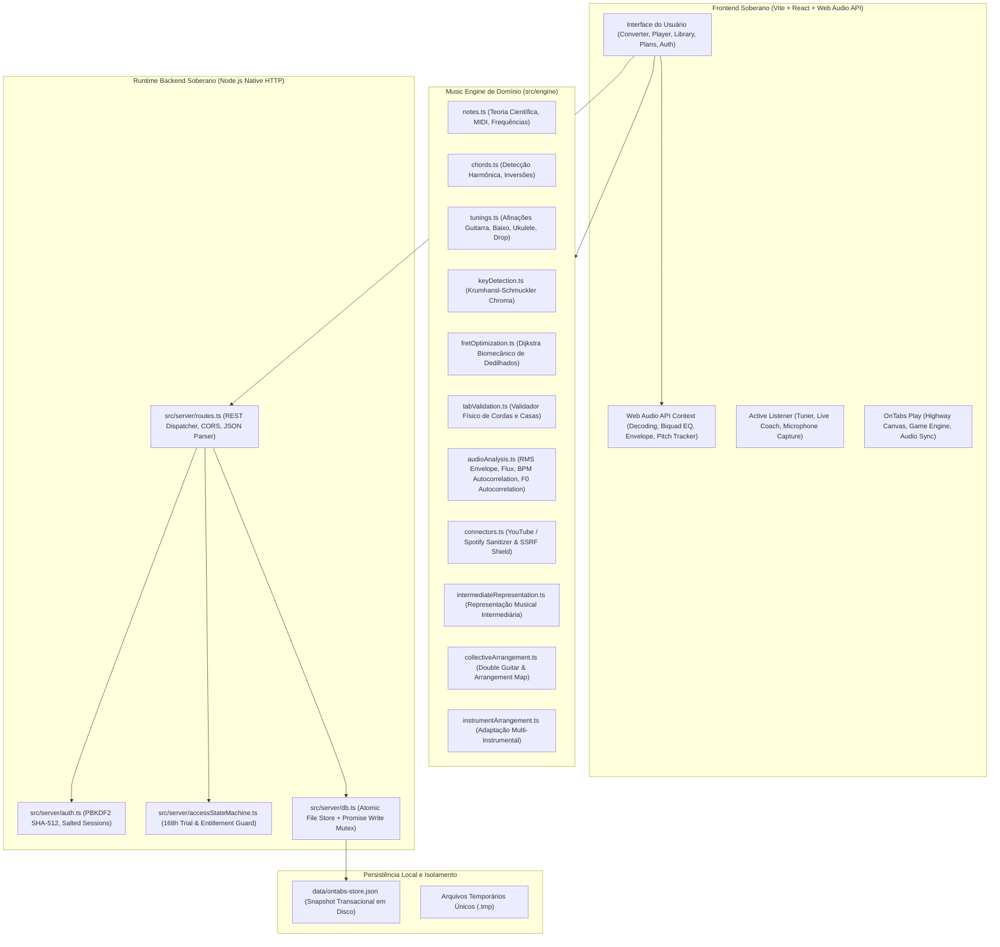

# OnTabs — Mapa da Arquitetura Soberana & Engenharia de Módulos (Phase 0/1)
**Identificador**: ONTABS-SPEC-ARCH-001  
**Classificação**: Arquitetura de Software, Modelagem Musical e Engenharia de Sistemas  
**Data**: 2026-10-19  
**Repositório Canônico**: `https://github.com/callmepewk/ontabs`  

---

## 1. Visão Geral da Arquitetura Soberana

O OnTabs opera como um sistema desacoplado, sem qualquer dependência dos runtimes ou créditos da Base44:

---

## 2. Inventário e Responsabilidade dos Componentes

### 2.1 Módulos do Motor Musical (`src/engine/`)

| Módulo | Arquivo | Responsabilidade | Status Real |
|---|---|---|---|
| **Notas & Teoria** | `notes.ts` | Conversão de notação científica para MIDI e frequências em Hz, equivalência enarmônica | `VERIFIED` |
| **Afinações** | `tunings.ts` | Mapeamento de cordas e afinações padrão e alternativas (Guitarra, Baixo, Violão, Ukulele) | `VERIFIED` |
| **Dicionário de Acordes** | `chords.ts` | Identificação de tríades, tétrades e acordes com sétima a partir de vetores de notas | `VERIFIED` |
| **Detecção de Tonalidade** | `keyDetection.ts` | Algoritmo Krumhansl-Schmuckler para identificar tonalidade maior/menor via perfil cromático | `VERIFIED` |
| **Otimização de Dedilhados** | `fretOptimization.ts` | Função de custo biomecânico para escolher a combinação corda/casa mais ergonômica | `VERIFIED` |
| **Validação Física** | `tabValidation.ts` | Rejeição de posições impossíveis no braço do instrumento e conflitos temporais de corda | `VERIFIED` |
| **Processamento de Áudio (DSP)** | `audioAnalysis.ts` | Envelope RMS, Novelty Spectral Flux, BPM por autocorrelação e detecção de $F_0$ por autocorrelação interpolada | `VERIFIED` |
| **Conectores de Mídia Externa** | `connectors.ts` | Sanitização de URLs do YouTube e Spotify, defesa contra SSRF e explicitação de capacidades | `VERIFIED` |
| **Representação Intermediária (IR)** | `intermediateRepresentation.ts` | Estrutura de dados temporal unificada que preserva áudio original, stems, notas, acordes e metadados | `IMPLEMENTED` *(Evoluído na Phase 0/1)* |
| **Arranjo Coletivo (CAI)** | `collectiveArrangement.ts` | Relações entre partes (uníssonos, dobras, complementos), Double Guitar Intelligence e Arrangement Map | `IMPLEMENTED` *(Evoluído na Phase 0/1)* |
| **Adaptação Instrumental** | `instrumentArrangement.ts` | Motor "Play It Your Way" para traduzir a representação musical entre instrumentos e dificuldades | `IMPLEMENTED` *(Evoluído na Phase 0/1)* |

---

### 2.2 Camada de Servidor & Segurança (`src/server/`)

| Componente | Arquivo | Responsabilidade | Mecanismo de Segurança |
|---|---|---|---|
| **Servidor HTTP** | `server.ts` | Inicialização do runtime Node.js sem dependências externas | Suporte a porta dinâmica e desligamento controlado |
| **Roteador REST** | `routes.ts` | Despacho de requisições, endpoints de autenticação, músicas, tablaturas, planos e conectores | Autorização prévia em todas as rotas protegidas |
| **Criptografia & Sessão** | `auth.ts` | Hash de senhas e gerenciamento de tokens de sessão com validade | `pbkdf2Sync` (100.000 iterações, salt 16 bytes, SHA-512) |
| **Máquina de Estados de Acesso** | `accessStateMachine.ts` | Controle de degustação gratuita única, 168h de trial e cotas mensais de assinantes | Relógio de servidor UTC estrito (resistente a clock tampering) |
| **Banco de Dados & Persistência** | `db.ts` | Persistência transacional multiusuário | Mutex de escrita em fila (`Promise.resolve()`) + escrita em arquivo `.tmp` único com rename atômico |

---

### 2.3 Camada Frontend & Aplicação (`src/pages/` e `src/services/`)

| Página / Serviço | Arquivo | Função no Produto | Estado de Hardening |
|---|---|---|---|
| **Conversor de Música** | `ConverterPage.tsx` | Upload de arquivo, resolução de links e geração de tablaturas com barra de etapas reais | Hardened com validação de arquivos e feedback de conectores |
| **Visualizador de Tablatura** | `TabViewerPage.tsx` | Renderização da tablatura, seções da música e player integrado | Visualização conectada à biblioteca |
| **Biblioteca de Músicas** | `LibraryPage.tsx` | Listagem paginada no servidor, busca por termo, filtro por instrumento e exclusão autorizada | Isolamento multiusuário comprovado por testes |
| **Planos & Assinaturas** | `PlansPage.tsx` | Exibição de planos (Free, Pro, Premium) e status de trial | Bloqueio honesto de checkout (402) em homologação |
| **Autenticação** | `LoginPage.tsx` / `RegisterPage.tsx` | Login, cadastro e ativação do trial Pro de 7 dias | Validação de senhas e emissão de tokens de sessão |
| **Serviço de Conversão** | `conversionService.ts` | Orquestração do pipeline Web Audio no navegador e persistência no backend | Detecção de $F_0$ real integrada; remoção de fórmulas falsas |
| **Serviço de Músicas** | `musicService.ts` | Interface cliente com o backend soberano para biblioteca e exclusão | Cabeçalhos `Bearer` e `X-Visitor-Id` gerenciados |
| **Serviço de Autenticação** | `authService.ts` | Armazenamento de sessão e consulta de direitos de acesso (entitlement) | Sincronizado com backend |
