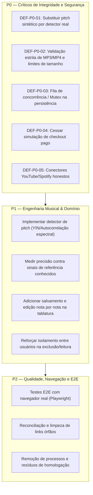

# OnTabs — Plano de Hardening e Garantia Funcional (Phase A/B)

**Data**: 2026-10-19  
**Responsável**: Antigravity — Hardening & Technical Assurance  
**Repositório Canônico**: `https://github.com/callmepewk/ontabs`  

---

## 1. Princípios de Execução

1. **Suspensão de Novas Telas Cosméticas**: Toda intervenção deve ser direcionada à correção de causas-raiz de integridade musical, segurança, persistência e honestidade funcional.
2. **Zero Falsificação de Resultados**: Se uma capacidade não puder ser executada de ponta a ponta (ex: transcrição polifônica em arquivo denso), o sistema deve declarar explicitamente sua limitação ao usuário em vez de sintetizar notas aleatórias.
3. **Padrão Negado e Validação Server-Side**: Nenhuma decisão de persistência ou permissão comercial deve ser aceita cegamente a partir do frontend.
4. **Evidência Reproduzível**: Cada defeito corrigido deve ser acompanhado de teste automatizado específico antes e depois da correção.

---

## 2. Backlog Priorizado de Hardening

---

## 3. Especificação Detalhada das Correções P0

### P0.1 — Ingestão Real e Validação de Mídia MP3 / MP4
- **Objetivo**: Garantir que apenas arquivos de mídia válidos com faixas de áudio compatíveis sejam aceitos, rejeitando arquivos corrompidos, vazios ou sem áudio antes de qualquer processamento custoso.
- **Contrato de Ingestão**:
  - Tamanho máximo: 30 MB (configurável via `MAX_UPLOAD_SIZE_BYTES = 30 * 1024 * 1024`).
  - Duração máxima: 600 segundos (10 minutos) para evitar pressão de memória no browser.
  - Tipos MIME aceitos: `audio/mpeg`, `audio/mp3`, `audio/wav`, `audio/ogg`, `video/mp4`.
  - Verificação de container MP4: extração de faixas de áudio; se `numberOfChannels === 0` ou duração for zero, rejeitar imediatamente com erro acionável: `"O arquivo de vídeo selecionado não contém uma faixa de áudio compatível."`
  - Rejeição de arquivos vazios (0 bytes) ou corrompidos com mensagem recuperável: `"Arquivo corrompido ou formato não decodificável pelo navegador."`

### P0.2 — Motor Musical Real: Detecção de Pitch (Frequência Fundamental)
- **Objetivo**: Eliminar o gerador de notas por módulo (`(Math.round(t) * 2) % 16`) e implementar estimador de pitch monofônico baseado em autocorrelação com normalização de sinal e limiar de clareza.
- **Implementação**:
  - Criar `estimatePitchAutocorrelation(samples, sampleRate, minFreq = 80, maxFreq = 1000)` em `src/engine/audioAnalysis.ts`.
  - Mapear a frequência detectada para número MIDI e cents de desvio via `frequencyToMidi(freq)`.
  - Associar o limiar de confiança do sinal: se o índice de periodicidade for inferior a 0.45, classificar o trecho como pausa ou transiente percussivo (não gerar nota fantasma).
  - Testar contra frequências conhecidas (ex: E2 = 82.4Hz, A2 = 110Hz, D3 = 146.8Hz, G3 = 196Hz, B3 = 246.9Hz, E4 = 329.6Hz, A4 = 440Hz).

### P0.3 — Persistência Segura com Serialização Assíncrona (Mutex)
- **Objetivo**: Evitar condições de corrida em escritas simultâneas no banco de dados em arquivo.
- **Implementação**:
  - Implementar uma fila de promessas (Lock / Mutex assíncrono) em `src/server/db.ts`.
  - Cada operação de escrita (`save()`, `createUser()`, `createSong()`, `deleteSong()`, `markVisitorFreeUseConsumed()`) aguarda a resolução da escrita anterior antes de persistir.
  - Implementar verificação de integridade no carregamento: backup automático (`.bak`) antes de sobrescrever.

### P0.4 — Conectores URL com Contrato Explícito
- **Objetivo**: Eliminar falsas alegações de extração de áudio de serviços com DRM / TOS restritivos.
- **Implementação**:
  - **YouTube**: Validação de formato da URL (regex para `youtube.com/watch?v=` ou `youtu.be/`). O conector informa claramente:
    > "O OnTabs respeita os termos de serviço e proteções de streaming. Este link registra metadados da faixa. Para transcrever a tablatura, selecione abaixo um arquivo de áudio local que você tenha autorização de uso."
  - **Spotify**: Validação de URLs `open.spotify.com/track/...`. Exibir que o Spotify não provê o arquivo mestre de áudio por API pública.
  - Ambos os fluxos criam a entrada com `status: 'awaiting_audio'` até que o áudio autorizado seja provido pelo usuário.

### P0.5 — Honestidade Comercial no Catálogo de Planos
- **Objetivo**: Eliminar a falsa simulação de upgrade de plano no frontend.
- **Implementação**:
  - O botão de seleção dos planos Pro e Premium deve exibir `Checkout Indisponível (Em Configuração)`.
  - O endpoint `POST /api/plans/select` deve rejeitar tentativas de atribuição direta de planos pagos enquanto a chave de produção do Stripe/Pix não estiver configurada no servidor.
  - Manter o Trial Pro de 168 horas operante como forma legítima de teste gratuito.

---

## 4. Plano de Testes de Regressão

| ID do Teste | Alvo | Condição Avaliada | Critério de Sucesso |
|---|---|---|---|
| `TEST-ING-01` | Ingestão MP3 | Arquivo MP3 sintético válido de 110Hz (A2) | Frequência ~110Hz detectada; nota A2 gerada |
| `TEST-ING-02` | Ingestão Mídia | Arquivo vazio (0 bytes) | Rejeição com erro explícito sem travar a UI |
| `TEST-ING-03` | Ingestão MP4 | Container MP4 sem faixa de áudio | Rejeição com `"Sem faixa de áudio compatível"` |
| `TEST-ING-04` | Ingestão Mídia | Arquivo > 30MB | Rejeição antes da decodificação |
| `TEST-CON-01` | Conector URL | Submissão de link do YouTube | Criação com `status: awaiting_audio`; sem áudio fictício |
| `TEST-CON-02` | Conector URL | Submissão de URL maliciosa (SSRF attempt, ex: `http://169.254.169.254`) | Rejeição imediata por host não autorizado |
| `TEST-DB-01` | Persistência | 10 gravações simultâneas concorrentes | Zero perda de registros; integridade mantida |
| `TEST-SEC-01` | Planos/Auth | Tentativa de mudar plano para 'premium' sem pagamento | Rejeitado com HTTP 402/403 pelo servidor |
